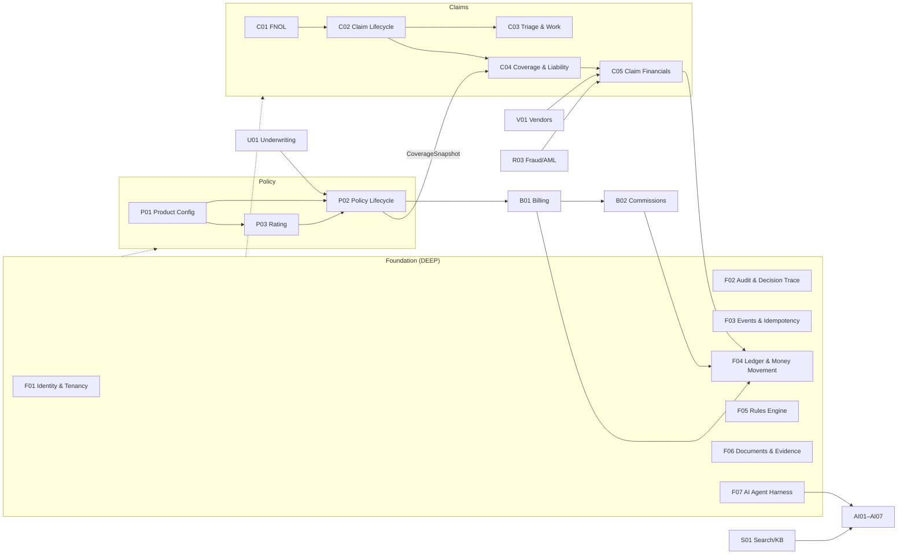

# Insurtech Platform — Product Specification Set

> Production-grade insurance platform: **Claims (primary) + Policy + Billing**, extensible to **Underwriting**.
> This folder is the coverage map and the product source of truth. Code in this repository is built against these documents and the [Code Rule Contract](CODE-RULE-CONTRACT.md).

| | |
|---|---|
| Spec set version | 0.1 (Draft) |
| Date | 2026-11-01 |
| Language / runtime | Java (see Contract §1, Technology Baseline) |
| Change process | PR against `spec/`; DEEP PRDs need sign-off from the owning domain lead + architecture |

---

## 1. What is in this folder

| Path | Purpose |
|---|---|
| [`README.md`](README.md) | This index: coverage map, depth vs. parallel tiers, dependency graph, success-criteria traceability |
| [`CODE-RULE-CONTRACT.md`](CODE-RULE-CONTRACT.md) | Normative engineering rules (MUST / SHOULD) with stable IDs `CRC-<AREA>-<NNN>` |
| [`GLOSSARY.md`](GLOSSARY.md) | Ubiquitous language. Class names, API fields, and event names MUST use these terms |
| [`prd/_TEMPLATE.md`](prd/_TEMPLATE.md) | Template for new PRDs |
| `prd/<NN-domain>/PRD-*.md` | One PRD per line of functionality (36 PRDs) |

### How to read a PRD

- **Tier** in each header is either **DEEP** (foundational: build first, highest quality gates, strong consistency) or **PARALLEL** (can be built concurrently once the DEEP interfaces it depends on are stable).
- **Requirement IDs**: `<PRD-ID>-P0-NN` = must-have, `P1` = fast follow, `P2` = future / architectural insurance (design must not preclude it).
- PRDs specify *what and why*, domain invariants, interfaces, events, and acceptance criteria. They are **not** implementation plans; sequencing is limited to dependency and phasing notes.
- **Success-metric targets are initial hypotheses**, to be baselined during the first 90 days in production. They are not claims about current performance.
- "**Producer**" means an insurance agent or broker. "**AI Agent**" means an LLM-based agent run by the harness. The bare word "agent" is avoided (see Glossary).

---

## 2. Coverage map

### 2.1 Foundation (cross-cutting, DEEP)

| ID | PRD | Tier | Owns (aggregates / capabilities) |
|---|---|---|---|
| F01 | [Identity, Access & Multi-tenancy](prd/00-foundation/PRD-F01-identity-access-tenancy.md) | DEEP | Tenant, Organization, Principal, Role, Authority Limit, PDP |
| F02 | [Audit & Decision Trace](prd/00-foundation/PRD-F02-audit-decision-trace.md) | DEEP | AuditRecord, DecisionRecord, integrity chain |
| F03 | [Event Backbone & Idempotency](prd/00-foundation/PRD-F03-event-backbone-idempotency.md) | DEEP | Event envelope, outbox/inbox, schema registry, idempotency store, sagas |
| F04 | [Financial Ledger & Money Movement](prd/00-foundation/PRD-F04-financial-ledger.md) | DEEP | Journal, Account, Posting Rule, Payment Order, Accounting Period, Reconciliation |
| F05 | [Rules & Decision Engine](prd/00-foundation/PRD-F05-rules-decision-engine.md) | DEEP | RuleSet, DecisionTable, DecisionResult |
| F06 | [Document & Evidence Model](prd/00-foundation/PRD-F06-document-evidence.md) | DEEP | Document, DocumentLink, Evidence custody, Extraction, Template |
| F07 | [AI Agent Harness Core](prd/00-foundation/PRD-F07-agent-harness-core.md) | DEEP | AI Agent definition, Tool registry, Run trace, Proposal, Approval gate, Eval harness, Model gateway |

### 2.2 Business domains

| ID | Domain | PRD | Tier |
|---|---|---|---|
| P01 | Policy | [Product Configuration & Coverage Model](prd/01-policy/PRD-P01-product-configuration.md) | DEEP |
| P02 | Policy | [Policy Lifecycle & Versioning](prd/01-policy/PRD-P02-policy-lifecycle.md) | DEEP |
| P03 | Policy / UW | [Rating & Pricing Engine](prd/01-policy/PRD-P03-rating-pricing.md) | PARALLEL |
| C01 | Claims | [FNOL Multi-Channel Intake](prd/02-claims/PRD-C01-fnol-intake.md) | PARALLEL |
| C02 | Claims | [Claim Lifecycle & State Machine](prd/02-claims/PRD-C02-claim-lifecycle-state-machine.md) | DEEP |
| C03 | Claims | [Assignment, Triage, Investigation & Work Management](prd/02-claims/PRD-C03-assignment-triage-work.md) | DEEP |
| C04 | Claims | [Coverage Determination & Liability Assessment](prd/02-claims/PRD-C04-coverage-liability.md) | DEEP |
| C05 | Claims | [Claim Financials: Reserves, Settlement, Payment & Recovery](prd/02-claims/PRD-C05-claim-financials.md) | DEEP |
| U01 | Underwriting | [Underwriting, Risk Scoring & Workbench](prd/03-underwriting/PRD-U01-underwriting-risk.md) | PARALLEL |
| B01 | Billing | [Premium Billing & Collections](prd/04-billing/PRD-B01-premium-billing-collections.md) | PARALLEL |
| B02 | Billing | [Commissions & Producer Compensation](prd/04-billing/PRD-B02-commissions.md) | PARALLEL |
| V01 | Vendors | [Vendor & Third-Party Management](prd/05-vendor/PRD-V01-vendor-management.md) | PARALLEL |
| X01 | Experience | [Customer Self-Service Portal](prd/06-experience/PRD-X01-customer-portal.md) | PARALLEL |
| X02 | Experience | [Producer (Agent/Broker) Portal](prd/06-experience/PRD-X02-producer-portal.md) | PARALLEL |
| X03 | Experience | [Mobile Experiences](prd/06-experience/PRD-X03-mobile.md) | PARALLEL |
| X04 | Experience | [Notifications & Communications Engine](prd/06-experience/PRD-X04-notifications-communications.md) | PARALLEL |
| R01 | Compliance | [Privacy, Consent & Data Retention](prd/07-compliance/PRD-R01-privacy-consent-retention.md) | PARALLEL (day-1 hooks) |
| R02 | Compliance | [Regulatory & Delegated-Authority Reporting](prd/07-compliance/PRD-R02-regulatory-reporting.md) | PARALLEL |
| R03 | Compliance | [Fraud, Sanctions & AML Signals](prd/07-compliance/PRD-R03-fraud-aml-signals.md) | PARALLEL |
| A01 | Analytics | [Analytics & Operational Intelligence](prd/08-analytics/PRD-A01-analytics-intelligence.md) | PARALLEL |
| S01 | Platform | [Search & Knowledge Base](prd/09-platform-services/PRD-S01-search-knowledge-base.md) | PARALLEL |
| S02 | Platform | [Integration Adapters](prd/09-platform-services/PRD-S02-integration-adapters.md) | PARALLEL |

### 2.3 AI Agents (all PARALLEL; all run on F07)

| ID | AI Agent | Default autonomy | PRD |
|---|---|---|---|
| AI01 | FNOL Intake & Structured Extraction | L2 Assist | [PRD-AI01](prd/10-ai-agents/PRD-AI01-fnol-extraction-agent.md) |
| AI02 | Document Understanding | L2 Assist | [PRD-AI02](prd/10-ai-agents/PRD-AI02-document-understanding-agent.md) |
| AI03 | Coverage & Policy Q&A (RAG) | L2 Assist | [PRD-AI03](prd/10-ai-agents/PRD-AI03-coverage-qa-rag-agent.md) |
| AI04 | Claim Triage & Prioritization | L2 Assist | [PRD-AI04](prd/10-ai-agents/PRD-AI04-triage-agent.md) |
| AI05 | Fraud Signal Summarization | L2 Assist (internal only) | [PRD-AI05](prd/10-ai-agents/PRD-AI05-fraud-summarization-agent.md) |
| AI06 | Communication Drafting | L3 Act-with-approval | [PRD-AI06](prd/10-ai-agents/PRD-AI06-communication-drafting-agent.md) |
| AI07 | Policy Wording Explanation & Endorsement Suggestion | L2 Assist | [PRD-AI07](prd/10-ai-agents/PRD-AI07-policy-wording-endorsement-agent.md) |

Autonomy levels (L0–L4) are defined in [F07](prd/00-foundation/PRD-F07-agent-harness-core.md) and constrained by Contract §14.

---

## 3. Depth vs. parallel

### 3.1 Go deep (foundational, highest quality)

These carry consistency, auditability, and domain-correctness obligations that are expensive or impossible to retrofit:

| Area | PRDs | Why it must be deep |
|---|---|---|
| Claim state machine & workflow | C02, C03 | Backbone of the primary domain; every other claims capability hangs off explicit states and transitions |
| Policy & coverage model | P01, P02, C04 | Versioned, effective-dated, rule-driven coverage is what makes coverage decisions deterministic and explainable |
| Financial integrity | F04, C05 | Double-entry, append-only, idempotent movements; reconcilable at any instant |
| Audit & decision trace | F02 | Every state change, AI recommendation, and override must be immutable and queryable from day one |
| Identity, permissions, tenancy | F01 | Carrier / producer / vendor / customer separation; authority limits on money |
| Document & evidence | F06 | Provenance and chain of custody cannot be reconstructed later |
| Agent harness core | F07 | AI must be governed (permissions, budgets, traces, gates, evals) before any agent ships |
| Event backbone & rules | F03, F05 | Side effects and configurable behavior across every domain depend on them |

### 3.2 Parallelizable (once the unlock interfaces below are stable)

FNOL channels (C01), portals (X01, X02), mobile (X03), notifications (X04), vendor flows (V01), billing and commissions (B01, B02), rating (P03), underwriting workbench (U01), analytics (A01), search/KB (S01), integration adapters (S02), compliance services (R01–R03), and every specific AI agent (AI01–AI07).

### 3.3 Unlock interfaces — stabilize these first

Parallel teams start once these contracts are published (OpenAPI / event schemas in the owning context's `-api` module) and frozen at `v1`:

| Interface | Owner | Unblocks |
|---|---|---|
| Event envelope, outbox, event catalog | F03 | Everyone |
| `AuthorizationPort` / PDP decision API, principal & tenant context | F01 | Everyone |
| `AuditPort` + DecisionRecord schema | F02 | Everyone |
| Rules `evaluate(ruleSetRef, asOf, facts)` | F05 | P01, P03, U01, C03, C04, R03, X04 |
| Document upload / link / retrieve API | F06 | C01, X01–X03, V01, AI02 |
| Ledger `post(journalRequest)` + `PaymentOrder` API | F04 | C05, B01, B02, V01 |
| Product definition read API (coverages, schemas, claim config) | P01 | P02, P03, C01, C04, U01 |
| `CoverageSnapshot getCoverageAsOf(policyRef, lossDateTime, knownAt)` | P02 | C02, C04, AI03 |
| Claim command & query API (register, assign, flag, close) | C02 | C01, C03, X01–X03, V01 |
| Tool registry + Proposal/approval API + Model gateway | F07 | AI01–AI07 |

---

## 4. Dependency graph (domain level)

---

## 5. System success criteria → traceability

| Success criterion | Primary PRDs | Verifiable by |
|---|---|---|
| A claim can move from FNOL to final settlement with full auditability | C01, C02, C03, C04, C05, F02 | End-to-end scenario suite per LOB; audit timeline reconstructs every transition (C02-P0, F02-P0) |
| Coverage decisions are deterministic and explainable (rules + AI assistance) | P01, P02, C04, F05, AI03 | Golden-file replay: same snapshot + facts + rule version ⇒ identical decision and explanation |
| Financial movements are reconcilable at any point | F04, C05, B01, B02 | Trial balance = 0 per currency at any instant; sub-ledger ⇄ GL ⇄ bank reconciliation reports |
| AI agents accelerate work but never silently override policy or financial rules | F07, F02, AI01–AI07 | Harness denylist tests; 100% of AI outputs persisted as DecisionRecords; no AI principal holds mutate grants on money/coverage |
| New products / LOBs mostly via configuration and rules | P01, P03, F05, C04 | "New LOB drill": add a product from supported patterns with zero code deploy |
| Operators can always see why a decision was made (human or AI) | F02, F05, F07 | "Why" view for any decision returns inputs, versions, explanation, actor, overrides |

---

## 6. Bounded contexts (code ownership)

Module naming and boundary rules are defined in Contract §2. Each context below (except the platform libraries `eventing` and `integration`, and the analytics platform) is deployed as its own microservice at `services/<ctx>/<ctx>-service` ([ADR-0001](../docs/adr/0001-microservices-per-bounded-context.md)); ports and tiers are listed in the [service catalog](../README.md#service-catalog).

| Context (`<ctx>`) | Owning PRDs | Notes |
|---|---|---|
| `identity` | F01 | PDP, principals, authority limits |
| `audit` | F02 | Append-only store, integrity verifier, query API |
| `eventing` (platform lib) | F03 | Outbox/inbox libraries, schema registry tooling, idempotency store |
| `ledger` | F04 | Journal, accounts, payment orders, reconciliation |
| `rules` | F05 | Rule authoring, versioning, evaluation |
| `documents` | F06 | Storage, provenance, templates, generation |
| `aiharness` | F07 | AI Agent registry, tools, runtime, gateway, evals |
| `product` | P01 | Product definitions and configuration lifecycle |
| `policy` | P02 | Quotes, policy terms, transactions, versions |
| `rating` | P03 | Rating plans, worksheets |
| `fnol` | C01 | Loss reports, channel adapters |
| `claims` | C02, C03, C04, C05 | Claim, Claim Line, Party, work items, coverage positions, reserves, recoveries |
| `underwriting` | U01 | Submissions, risk scores, referrals |
| `billing` | B01 | Billing accounts, invoices, receipts, delinquency |
| `commissions` | B02 | Commission plans, statements |
| `vendors` | V01 | Vendor registry, assignments, invoices |
| `notifications` | X04 | Templates, sends, delivery tracking |
| `privacy` | R01 | Classification, consent, DSR, retention, crypto-shredding |
| `regreporting` | R02 | Report definitions, data marts, submissions |
| `fraud` | R03 | Signals, screening, SIU cases |
| `search` | S01 | Indexes, knowledge base, retrieval |
| `integration` | S02 | Adapters (one module per external system family) |
| `bff-customer`, `bff-producer`, `bff-vendor`, `bff-mobile` | X01–X03, V01 | No domain logic (CRC-ARCH-011) |
| analytics platform (outside JVM services) | A01 | Consumes events / CDC only |
